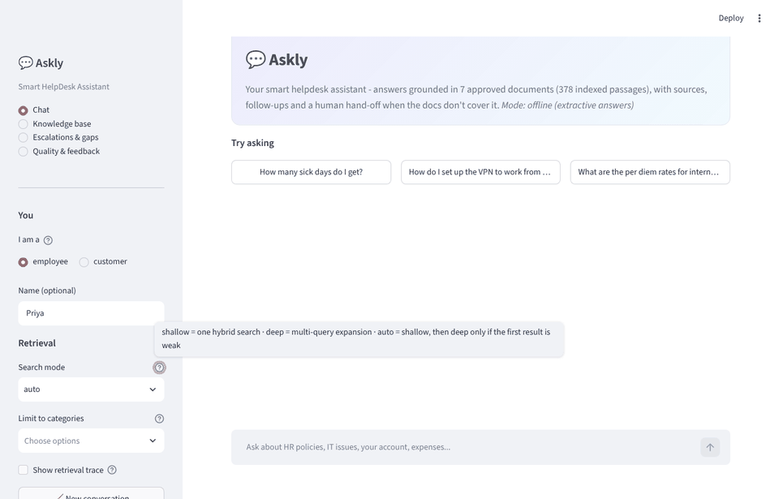
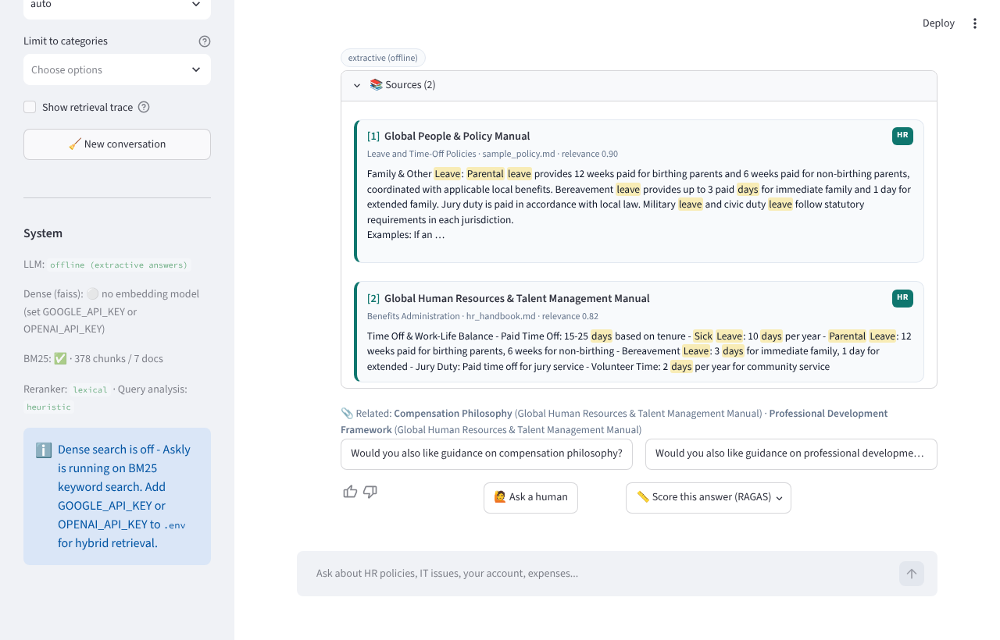
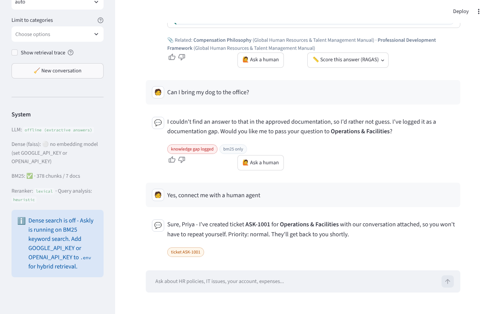
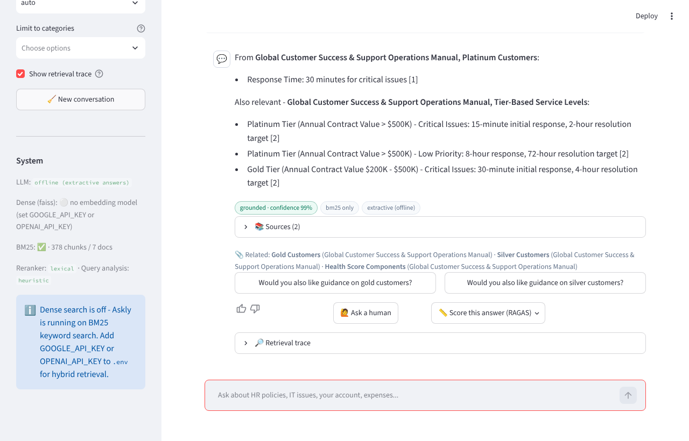
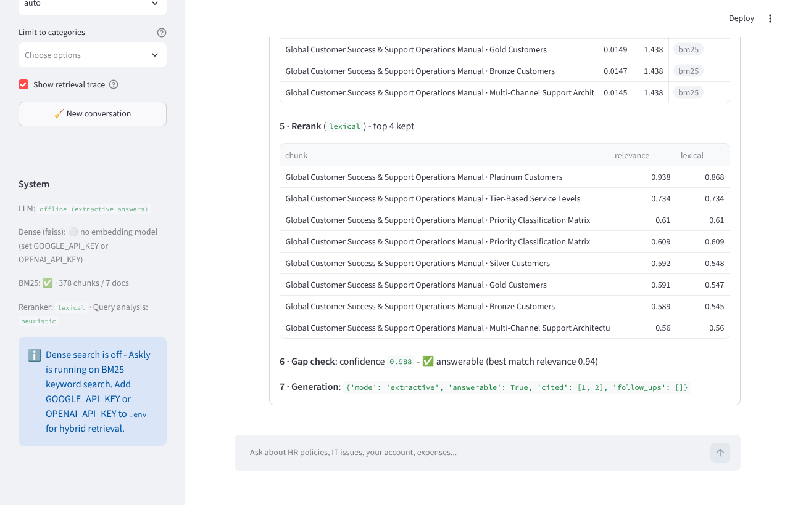
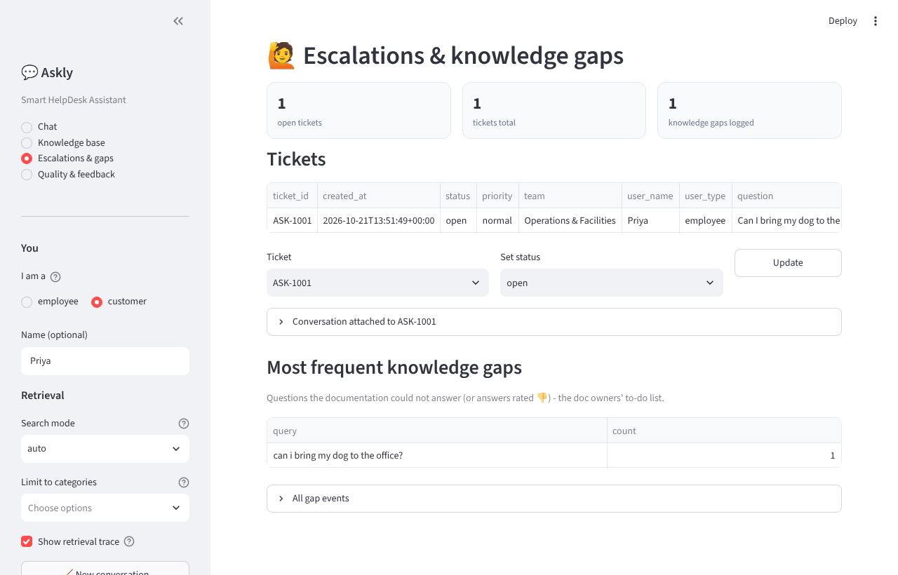
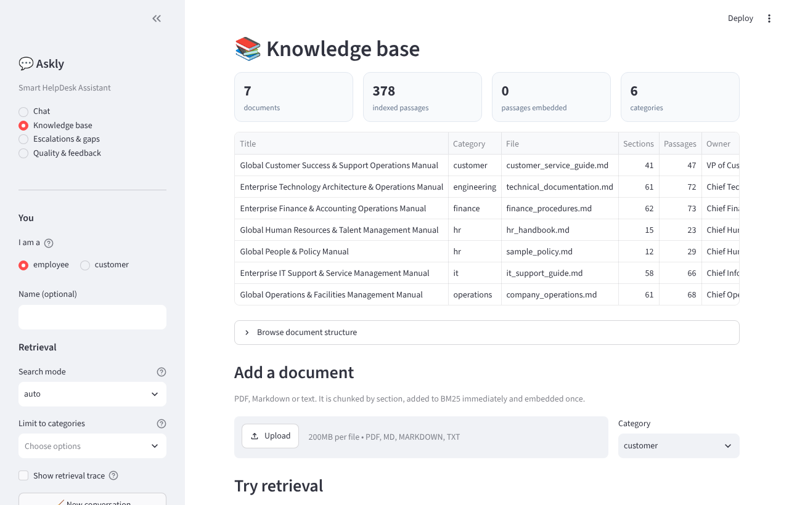
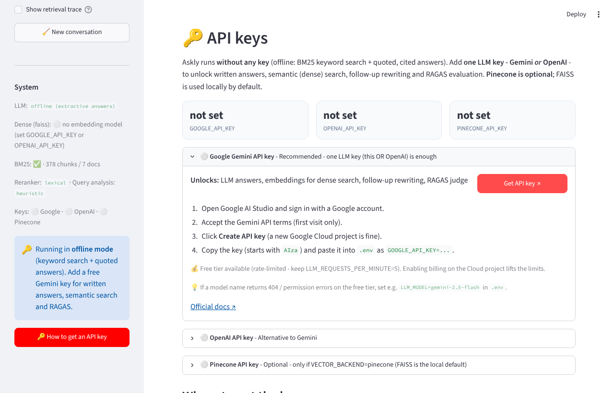
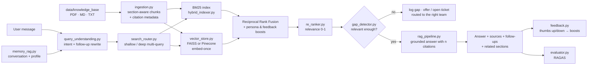

# Askly — Smart HelpDesk Assistant

> An LLM-powered helpdesk that answers employee and customer questions from enterprise
> documentation, **with sources**, remembers the conversation, suggests next steps, and hands
> off to a human when the documents don't have the answer.



---

## Project overview

**The problem.** Enterprises keep policies, IT wikis, FAQs and onboarding guides in scattered
documents. Traditional helpdesk bots give rigid one-off answers, can't handle follow-ups
("…and what about sick leave?"), fail silently when the documentation is incomplete, and leave
support teams answering the same tickets again and again.

**The approach.** Askly is a Retrieval-Augmented Generation (RAG) pipeline:

1. **Ingest** - manuals (PDF / Markdown / text) are split along their own headings into
   section-level passages that carry citation metadata (document, section, page, owner).
2. **Understand** - each message is classified (question, greeting, "talk to a human"…) and
   follow-ups are rewritten into standalone questions using the conversation history.
3. **Retrieve** - hybrid search: **BM25** keyword search + **dense embeddings** (FAISS or
   Pinecone), fused with Reciprocal Rank Fusion, then **reranked**.
4. **Check** - if the best passage isn't relevant enough, Askly says so, logs a knowledge gap
   and escalates to the right team instead of guessing.
5. **Answer** - the LLM (Gemini or OpenAI) answers **only** from the numbered passages, cites
   them as `[n]`, flags conflicting documents, and proposes follow-up help.
6. **Learn & measure** - 👍/👎 feedback re-weights retrieval; **RAGAS** scores faithfulness,
   relevance, context precision/recall and correctness on a labelled test set.

It runs on the **Orion Digital Services Enterprise Knowledge Base** (7 manuals: HR, people &
policy, IT support, finance, customer success, operations, technology - 378 passages), and works
**without an API key** too (keyword search + quoted, cited answers), so anyone can try it.

---

## Key features

| | Feature | What it does |
|---|---|---|
| 💬 | **Context-aware multi-turn chat** | "How many sick days do I get?" → "And what about parental leave?" is resolved from memory; the rewritten question is shown to the user |
| 🔎 | **Hybrid retrieval + reranking** | BM25 (exact terms like "401(k)", "PTO") + embeddings (meaning), merged with Reciprocal Rank Fusion; cross-encoder, LLM or lexical reranker |
| 📚 | **Transparent answers** | Every answer cites `[n]` sources with document, section, page, link and a highlighted snippet |
| 🧭 | **Proactive guidance** | Suggests the next question and related sections ("Would you also like guidance on…?") |
| 🚨 | **Knowledge-gap detection & escalation** | Refuses to guess; logs gaps for doc owners; opens tickets routed to HR / IT / Finance / Ops… automatically when urgent, asked, or after repeated misses |
| ⚖️ | **Conflict awareness** | When documents disagree (e.g. 2 vs 3 office days), Askly cites both instead of picking one |
| 👤 | **Personalisation** | Employee vs customer persona changes ranking and tone |
| 👍 | **Feedback loop** | Ratings boost/penalise the passages behind an answer in future searches |
| 📏 | **RAGAS evaluation** | Faithfulness, answer relevancy, context precision & recall, answer correctness + source hit-rate / MRR / gap accuracy, with a cost estimate before each run |
| 🔍 | **Explainability** | Optional step-by-step trace: BM25 vs dense hits, fusion table, rerank scores, gap check, raw LLM reply |
| 🔑 | **Guided key setup** | In-app page with links to get Gemini / OpenAI / Pinecone keys, key status, a test call, and paste-a-key for local runs |
| 🔌 | **Graceful degradation** | No key → offline mode; no Pinecone → FAISS; embeddings computed once and cached |

---

## Tech stack

| Layer | Tools |
|---|---|
| Language | Python 3.12+ |
| LLM & embeddings | Google **Gemini** (`langchain-google-genai`) or **OpenAI** (`langchain-openai`) |
| Orchestration | **LangChain** (chat models, embeddings, text splitters, rate limiter) |
| Dense retrieval | **FAISS** (local, default) or **Pinecone** (managed) |
| Sparse retrieval | **BM25** (`rank-bm25`) |
| Reranking | Cross-encoder (`sentence-transformers`, optional) · LLM · lexical |
| Evaluation | **RAGAS** 0.4 |
| Validation & config | **Pydantic** schemas, `pydantic-settings`, **python-dotenv** |
| UI | **Streamlit** |
| Data / docs | `pypdf`, Pandas, `reportlab` (sample PDFs) |
| Testing | `pytest` (offline: fake embeddings + fake chat model) |

---

## Demo

| Multi-turn follow-up with cited sources | Knowledge gap → escalation ticket |
|---|---|
|  |  |
| **Customer persona - conflicting SLA values shown with their labels** | **Retrieval trace (fusion, rerank, gap check)** |
|  |  |
| **Escalation queue & knowledge-gap log** | **Knowledge base browser & upload** |
|  |  |
| **🔑 API keys page - where to get each key, status, test call** | |
|  | |

*Screenshots were captured in offline mode (no API key), so the answers are quoted passages. With a
Gemini/OpenAI key they become written, step-by-step answers with the same citations.*

---

## Setup instructions

### Install

```bash
git clone https://github.com/<your-username>/Askly-AI.git
cd Askly-AI
python -m venv .venv
source .venv/bin/activate          # Windows: .venv\Scripts\activate
pip install -r requirements.txt
cp .env.example .env               # Windows: copy .env.example .env  - then add your key (optional)
```

> **API keys stay out of git.** They are read from `.env` (via python-dotenv / pydantic-settings),
> and `.env` is listed in `.gitignore`. Only `.env.example`, with empty values, is committed.

Minimal `.env` for the full experience:

```
GOOGLE_API_KEY=your-gemini-key        # or OPENAI_API_KEY=...
# COMPANY_NAME=Orion Digital Services  # optional - detected from the documents
VECTOR_BACKEND=faiss                  # or pinecone + PINECONE_API_KEY
```

Optional local cross-encoder reranker: `pip install sentence-transformers` and set
`RERANKER_MODEL=cross-encoder/ms-marco-MiniLM-L-6-v2`.

**Free-tier limits:** all LLM calls share one rate limiter (`LLM_REQUESTS_PER_MINUTE`, default
5). The first question in a conversation costs 1 LLM call; later turns cost 2 (the
conversation-aware rewrite + the answer), plus 1 embedding call each. `auto` mode adds one more call
only when the first search comes back weak. RAGAS is much heavier — the app and CLI show the
estimate before running.

---

### Get API keys (optional)

Askly runs without keys. **One LLM key - Gemini _or_ OpenAI - unlocks everything**; Pinecone is
optional. The app has an **🔑 API keys** page with the same steps, a key-status check and a
"test the connection" button.

| Key (`.env` variable) | Needed? | Where to get it | Cost |
|---|---|---|---|
| `GOOGLE_API_KEY` | Recommended (this **or** OpenAI) | [Google AI Studio → Create API key](https://aistudio.google.com/app/apikey) | Free tier (rate-limited) |
| `OPENAI_API_KEY` | Alternative | [OpenAI Platform → API keys](https://platform.openai.com/api-keys) (add a payment method under [Billing](https://platform.openai.com/settings/organization/billing) first) | Pay-as-you-go |
| `PINECONE_API_KEY` | Optional (`VECTOR_BACKEND=pinecone`) | [Pinecone console](https://app.pinecone.io/organizations/-/projects) → project → API keys → **+ API key** | Starter plan available |

1. **Gemini:** sign in at Google AI Studio, accept the terms, click **Create API key**, copy the key
   (starts with `AIza`). If the default model isn't available on your tier, set
   `LLM_MODEL=gemini-2.5-flash`. ([docs](https://ai.google.dev/gemini-api/docs/api-key))
2. **OpenAI:** sign up, verify email/phone, add billing, then **Create new secret key**; it is shown
   only once. Set `LLM_PROVIDER=openai` if you also have a Gemini key.
   ([docs](https://platform.openai.com/docs/quickstart))
3. **Pinecone:** open your project → **API keys** → **+ API key** → copy it (shown only once), then set
   `VECTOR_BACKEND=pinecone`. Askly creates the `askly` index (dimension 768).
   ([docs](https://docs.pinecone.io/guides/projects/manage-api-keys))

Put them in `.env` (never commit it):

```bash
GOOGLE_API_KEY=AIza...            # or OPENAI_API_KEY=sk-...
# VECTOR_BACKEND=pinecone
# PINECONE_API_KEY=pcsk_...
```

### Run

```bash
python main.py              # checks setup, indexes, runs the 5 demo scenarios, opens a menu
python main.py --chat       # chat in the terminal (/good, /bad, /escalate, /new, /quit)
python main.py --eval       # evaluation only
python main.py --offline    # ignore API keys
streamlit run streamlit/app.py
pytest -q                   # 13 offline end-to-end tests
```

Demo scenarios in `main.py` (all on the Orion KB): the medical-leave → sick-leave follow-up, an
account lockout with proactive next steps, a customer SLA question, a question the documents answer
inconsistently, and an unanswerable question that turns into a routed ticket.

---

## Table of contents (deep dive)

1. [How it works](#how-it-works)
2. [Project structure](#project-structure)
3. [Module reference](#module-reference)
4. [The Streamlit app](#the-streamlit-app)
5. [The knowledge base](#the-knowledge-base)
6. [Evaluation](#evaluation)
7. [Design notes](#design-notes)
8. [Problem statement → implementation](#problem-statement--implementation)
9. [Extending Askly](#extending-askly)

---

## How it works



One conversational turn (`AsklyAssistant.ask()`):

| Step | Module | What happens |
|------|--------|--------------|
| 1. Understand | `query_understanding.py` | Detects intent (question / greeting / thanks / "talk to a human" / off-topic) and rewrites follow-ups: *"And what about sick leave?"* → *"How do I apply for sick leave?"* |
| 2. Retrieve | `search_router.py` → `hybrid_indexer.py` | BM25 + dense search, fused with Reciprocal Rank Fusion; customers' results lean towards product docs, employees' towards internal policies |
| 3. Rerank | `re_ranker.py` | Scores each (question, passage) pair 0–1 and keeps the best 4 |
| 4. Gap check | `gap_detector.py` | Best relevance below `GAP_THRESHOLD` → "not in the docs", log the gap, offer escalation |
| 5. Generate | `rag_pipeline.py` | LLM answers **only** from numbered passages, cites `[n]`, gives steps for how-tos, and says `answerable=false` rather than guess |
| 6. Proactive | `rag_pipeline.py` | Follow-up offers (*"Would you also like guidance on updating your 2FA settings?"*) and related sections from the same document |
| 7. Remember | `memory_rag.py` | Turn stored; feeds the next follow-up |
| 8. Learn | `feedback.py` / `evaluator.py` | 👍/👎 nudges future retrieval; RAGAS measures quality |

**Works without API keys.** With no key, Askly runs on BM25 + lexical reranking and gives
*extractive* answers (the cited sentences themselves). Add a Gemini or OpenAI key to turn on
dense retrieval, LLM answers, LLM query rewriting and RAGAS.

---

## Project structure

The layout mirrors the course's HireFlow project: one `core/` module per pipeline stage, shared
`utils/`, a CLI orchestrator (`main.py`) and a Streamlit UI.

```
Askly/
├── main.py                    # CLI: prerequisites → index → demo conversations → menu
├── requirements.txt
├── .env.example               # every setting, documented
├── README.md
├── LICENSE
├── docs/images/               # screenshots + demo GIF used in this README
│
├── core/                      # the pipeline, one module per stage
│   ├── ingestion.py           # 1. files → section-aware chunks with citation metadata
│   ├── vector_store.py        # 2. dense retrieval: FAISS (local) or Pinecone, embed-once
│   ├── hybrid_indexer.py      # 3. BM25 + dense, Reciprocal Rank Fusion, boosts, trace
│   ├── re_ranker.py           # 4. cross-encoder / LLM / lexical reranking → relevance 0-1
│   ├── query_understanding.py # 5. intent detection + follow-up rewriting
│   ├── search_router.py       # 6. shallow vs deep (multi-query) retrieval, personalisation
│   ├── gap_detector.py        # 7. knowledge gaps, escalation tickets, team routing
│   ├── feedback.py            # 8. thumbs up/down store → retrieval boosts
│   ├── memory_rag.py          # 9. per-session conversation memory + user profile
│   ├── rag_pipeline.py        # 10. AsklyAssistant: orchestrates a turn
│   └── evaluator.py           # 11. RAGAS (+ offline proxies) on a labelled test set
│
├── utils/
│   ├── config.py              # settings from .env (pydantic-settings)
│   ├── schemas.py             # Pydantic: Citation, AskResponse, EscalationTicket, ...
│   ├── multi_query.py         # alternative phrasings for "deep" retrieval
│   └── utils.py               # LLM/embedding factories, shared rate limiter, tokenizer, PDF, JSONL
│
├── streamlit/
│   ├── app.py                 # chat UI + knowledge base, escalations, quality pages
│   └── ui_helpers.py          # CSS, badges, source cards
│
├── data/
│   ├── knowledge_base/        # the Orion Enterprise Knowledge Base (7 Markdown manuals, flat folder)
│   ├── sample_knowledge_base/ # small "Acme Corp" demo KB incl. 2 PDFs (used by the PDF ingestion test)
│   ├── examples.json          # example questions shown in the UI, per audience
│   ├── eval/testset.json      # 20 labelled questions (follow-up, conflicts, 2 unanswerable)
│   ├── index/                 # generated: FAISS index + embed-once manifest
│   └── state/                 # generated: tickets, knowledge gaps, feedback, evaluation history
│
├── scripts/
│   ├── make_sample_pdfs.py    # rebuilds the two sample PDFs from scripts/pdf_sources/
│   └── pdf_sources/
└── tests/test_pipeline.py     # 13 end-to-end tests, run offline (fake embeddings / fake LLM)
```

---

## Module reference

### `core/ingestion.py` — documents → chunks
`load_knowledge_base(dir)` walks `data/knowledge_base/`; the first sub-folder is the
document's **category**, or - for a flat folder like the Orion KB - it's inferred from the file
name (`it_support_guide.md` → `it`, `company_operations.md` → `operations`, `technical_documentation.md`
→ `engineering`, …). Lines inside ``` code fences are never treated as headings, `**Document Owner**:` /
`Last Updated:` lines become document metadata, and the organisation subtitle
(`## Orion Digital Services, Inc.`) is recorded as the company name rather than as a section. Each file is split by its own headings (Markdown `#`/`##`/`###`,
numbered PDF headings like `4.2 Sick Leave`), so every chunk is about one topic and carries
`section`, `parent_section`, `page`, `url`, `source`, `category` for its citation. Long sections
are split further with overlap. Every chunk starts with a context header
(`HR Handbook > 4 Leave Policy > 4.2 Sick Leave`) so it's findable by its heading even when
the body never repeats those words. Markdown files may carry front matter (`title`,
`category`, `url`, `owner`, `last_updated`). Chunk ids are stable (`doc::section::n`) and
carry a content hash, so unchanged chunks are never re-embedded.

### `core/vector_store.py` — dense retrieval
`VectorStore(backend="faiss"|"pinecone")`. `sync(chunks)` embeds only new or changed chunks
(batched), deletes removed ones and records what's embedded in a manifest — restarting the
app costs zero embedding calls. If the embedding model changes, the FAISS index is rebuilt; a
Pinecone index with the wrong dimension is **never** deleted automatically. `search()` returns
cosine similarity and supports `{"category": [...]}` filters. Every method fails soft.

### `core/hybrid_indexer.py` — BM25 + dense with RRF
BM25 over the chunks (section headings weighted ×2) plus the vector store, for one or more
query phrasings, fused with **Reciprocal Rank Fusion** (`Σ 1/(60+rank)`) — rank positions, not raw
scores, because BM25 scores are unbounded and cosine is 0–1. Two soft multipliers: category
boosts (persona + detected topic) and feedback boosts. `trace=` records every step for the UI.

### `core/re_ranker.py` — reranking
`RERANKER=auto` uses a **cross-encoder** (`RERANKER_MODEL`, e.g.
`cross-encoder/ms-marco-MiniLM-L-6-v2`) if installed, otherwise the **lexical** reranker: IDF-weighted
coverage of the question's terms in the passage and its heading, blended with the fused rank and the
dense cosine. `RERANKER=llm` scores all candidates in one LLM call (accepted only if every passage
is scored). A small persona nudge breaks near-ties between "Customer Password Reset" and
"Employee Password Reset".

### `core/query_understanding.py` — intent + follow-ups
With an LLM: one JSON call (only when there is conversation history) returns intent,
`is_follow_up`, the standalone rewrite and a category. Without: regex intents and follow-up cues
("and…", "what about…", pronouns, very short turns) merged with the previous question.

### `core/search_router.py` — shallow vs deep
`shallow` = one hybrid search; `deep` = multi-query expansion (3 phrasings) fused together;
`auto` (default) runs shallow and only goes deep when the best passage is weak and an LLM is
available to rephrase. The reranker always judges against the user's own question.

### `core/gap_detector.py` — knowledge gaps and escalation
Two checks: retrieval relevance below `GAP_THRESHOLD` before generation, and the LLM's
`answerable=false` after it. Gaps go to `data/state/knowledge_gaps.jsonl` (most frequent
first = the documentation team's to-do list). Askly **opens a ticket automatically** when the
user asks for a human, when the message is urgent or security-sensitive (locked out, stolen,
hacked…), or after two unanswered questions in a row; otherwise it **offers** escalation.
Tickets (`ASK-1001`…) are routed by category to HR, IT Service Desk, Information Security,
Finance, Customer Support or Onboarding, with the conversation attached.

### `core/feedback.py` — the feedback loop
👍/👎 (and optional comment) per answer, stored with the cited chunk ids. `chunk_boosts()` turns
them into a smoothed ±30% multiplier per chunk that the hybrid ranker applies, and every 👎 is also
logged as a gap candidate.

### `core/memory_rag.py` — conversation memory
Per-session `HumanMessage`/`AIMessage` history (each user message stores its standalone
rewrite), the user profile (name, employee/customer), every turn's full response (for feedback
and escalation) and the consecutive-gap counter. Unlike HireFlow's search log, this memory is
fed back into query rewriting and the answer prompt.

### `core/rag_pipeline.py` — `AsklyAssistant`
Wires everything together. `ask(question, session_id, mode, filters, debug)` returns an
`AskResponse` (answer, citations, follow-ups, related resources, confidence, gap/escalation
flags, contexts for RAGAS, optional trace). Citations are renumbered `[1]..[k]` in order of use
and invalid numbers are dropped. Also: `escalate()`, `record_feedback()`, `add_document()`, `status()`.

### `core/evaluator.py` — RAGAS
`RAGEvaluator(assistant).run()` replays `data/eval/testset.json` through the real assistant
(follow-up items replay their history first) and scores it with **faithfulness, answer
relevancy, context precision, context recall and answer correctness**, plus retrieval metrics
that need no LLM (**source hit rate, MRR, gap-detection accuracy, false-gap rate**). Without a
key it computes clearly-labelled token-overlap proxies instead. `estimate_cost()` is shown
before every run; `judge_failed` distinguishes "unknown" from "bad"; results are appended to
`data/state/evaluations.csv`. `score_answer()` scores one live answer (used by the UI).

---

## The Streamlit app

`streamlit run streamlit/app.py`

- **Chat** — pick *employee* or *customer* (changes retrieval and tone), ask in natural
  language, follow up naturally. Every answer shows confidence, how a follow-up was understood,
  the search type, an expandable **Sources** panel (document, section, page, link, highlighted
  snippet), related sections, clickable follow-up suggestions, 👍/👎, **Ask a human**, and
  **Score this answer (RAGAS)**. Tick *Show retrieval trace* to see BM25 vs dense hits, the RRF
  table, rerank scores, the gap check and the raw LLM reply.
- **Knowledge base** — documents with owners, update dates and links; browse each document's
  section tree; upload a new PDF/Markdown/text file (indexed into BM25 immediately and embedded
  once); try retrieval for any query.
- **Escalations & gaps** — ticket queue with status updates and the attached conversation; most
  frequent knowledge gaps.
- **Quality & feedback** — ratings, how feedback is re-weighting passages, a RAGAS run with its
  cost estimate first, per-question results, and a chart of past runs.

---

## The knowledge base

`data/knowledge_base/` holds the **Orion Digital Services Enterprise Knowledge Base** - 7 Markdown
manuals, ~180 KB, indexed as **378 section-level passages**:

| File | Document | Category (inferred) |
|------|----------|---------------------|
| `hr_handbook.md` | Global Human Resources & Talent Management Manual | hr |
| `sample_policy.md` | Global People & Policy Manual (leave, hybrid work, conduct, grievances) | hr |
| `it_support_guide.md` | Enterprise IT Support & Service Management Manual | it |
| `finance_procedures.md` | Enterprise Finance & Accounting Operations Manual (travel, payroll) | finance |
| `customer_service_guide.md` | Global Customer Success & Support Operations Manual (SLAs, escalation) | customer |
| `company_operations.md` | Global Operations & Facilities Management Manual (safety, emergencies) | operations |
| `technical_documentation.md` | Enterprise Technology Architecture & Operations Manual | engineering |

The company name used in prompts and greetings ("Orion Digital Services") is detected from the
documents; override it with `COMPANY_NAME` in `.env`. Example questions live in `data/examples.json`.

**What indexing this KB revealed** (useful for the documentation owners - this is exactly the
"inconsistent or outdated responses" compliance risk from the problem statement):

| Topic | Conflict / gap |
|-------|----------------|
| Hybrid work | People & Policy Manual: office-aligned roles onsite **2 days/week**. Operations Manual: standard model **3 days in office**, 2 remote |
| Payroll | Finance Manual: "**Bi-weekly** payroll processing" but pay dates "**15th and last day of month**" (twice-monthly) |
| Platinum SLA | Customer Manual "Tier-Based Service Levels": critical = **15-minute** response, ACV > $500K. "Platinum Customers": **30 minutes**, ACV > $100K |
| Password reset | No end-user password-reset procedure anywhere (only "Tier 1 handles password resets" and an API endpoint) - Askly treats it as a gap rather than inventing steps |
| Pets, stock options | Not covered - used as the two "should say I don't know" test questions |

With an LLM key, Askly is instructed to state such conflicts and cite both sources instead of
silently picking one; offline, both passages appear in the extractive answer with their labels.

**Use different data:** replace the files in `data/knowledge_base/` (flat or `<category>/`
sub-folders; PDF, Markdown or text) or upload them in the app, then update `data/eval/testset.json`
and `data/examples.json`. A small Acme-Corp demo KB with PDFs is kept in `data/sample_knowledge_base/`
(`KNOWLEDGE_BASE_DIR=data/sample_knowledge_base` to use it).

---

## Evaluation

`data/eval/testset.json` has 20 questions across all 7 manuals: a multi-turn follow-up, two
questions whose answer is contested between documents, a customer-persona SLA question and two
unanswerable ones. Offline baseline (BM25 + lexical rerank + extractive answers, no API key):

| Metric | Value |
|--------|-------|
| Source hit rate / MRR | 0.94 / 0.92 |
| False-gap rate | 0.00 (no answerable question refused) |
| Gap-detection accuracy | 0.50 - "pets" detected; "stock option vesting" isn't, because the benefits section contains "options" (insurance buy-up) and "vesting" (401k) |
| Faithfulness (proxy) | 1.00 - extractive answers quote the source |
| Answer correctness (proxy) | ~0.40 - extractive answers are terse quotes vs. full reference answers |

The one retrieval miss ("How do I set up the VPN to work from home?") goes to the Operations
manual's remote-work policy ("VPN required", "home office setup") instead of the IT manual's VPN
Setup steps. Dense embeddings fix this kind of miss, and the LLM's "answerable" check is what
catches the stock-option case, so expect both numbers to improve with a key. With a key the same
command runs real RAGAS (faithfulness, answer relevancy, context precision and recall, answer
correctness).

---

## Design notes

| Area | Choice | Why |
|------|--------|-----|
| Chunking | By document section, with a heading-path header | Citations need a section/page; one topic per chunk; headings make chunks findable |
| Hybrid merge | Reciprocal Rank Fusion | BM25 and cosine scores aren't on the same scale; rank positions are |
| Embeddings | Embed-once manifest keyed by content hash | Restarts and re-indexing cost nothing; edited sections are re-embedded alone |
| Reranker default | Cross-encoder or lexical; LLM opt-in | An LLM rerank adds a call per question — ~2× slower on a 5/min free tier |
| Gap detection | Before *and* after generation | Retrieval scores catch "nothing relevant"; the model catches "relevant but doesn't say" |
| Escalation | Automatic only when asked, urgent, or repeated | Users decide on a single miss; nobody has to ask twice when it matters |
| Follow-ups | Rewritten to a standalone query before retrieval | Search engines can't resolve "what about sick leave?"; the rewrite is shown to the user |
| Personalisation | Soft boosts, never filters | Customers shouldn't lose a relevant HR answer to a hard filter |
| Offline mode | Extractive answers | Still grounded and cited; the app is usable and testable without keys |
| Tests | Fake embeddings + fake chat model | Every path (FAISS, LLM generation, "not answerable") is tested without network |

---

## Problem statement → implementation

| Requirement | Where |
|-------------|-------|
| Context-aware, multi-turn assistance | `query_understanding.py`, `memory_rag.py` |
| Proactive support (next steps, related resources) | `rag_pipeline._related_resources`, LLM `follow_ups` |
| Hybrid retrieval: dense + sparse (BM25) | `vector_store.py`, `hybrid_indexer.py` |
| Reranking models | `re_ranker.py` (cross-encoder / LLM / lexical) |
| Transparent answers: references, snippets, links | `Citation` schema, Sources panel, CLI "Sources:" |
| Knowledge-gap detection + intelligent escalation | `gap_detector.py` |
| RAGAS: faithfulness, relevancy, context precision & recall, correctness | `evaluator.py` |
| Feedback loop | `feedback.py` → `HybridIndexer` boosts |
| Python 3.12+, OpenAI/Gemini, FAISS/Pinecone, BM25, LangChain, Streamlit, dotenv, Pydantic | `requirements.txt`, `utils/config.py` |

---

## Extending Askly

- **Add a document type:** add a parser in `core/ingestion.py` that returns sections (`heading`, `page`, `text`).
- **Change retrieval:** tune `RRF_K`/boosts in `hybrid_indexer.py`, or the `auto` rule in `search_router.py`.
- **Better reranking:** set `RERANKER_MODEL` to a cross-encoder, or `RERANKER=llm`.
- **Tighten/loosen "I don't know":** `GAP_THRESHOLD` in `.env`.
- **Route tickets elsewhere:** `TEAM_ROUTING` in `gap_detector.py` (swap the JSONL for Jira/ServiceNow there).
- **Domain vocabulary:** add spelling variants to `_NORMALISE` in `utils/utils.py` (e.g. product names).
- **Another LLM / vector DB:** `get_llm()` / `get_embeddings()` in `utils/utils.py`; `VectorStore` backends.
